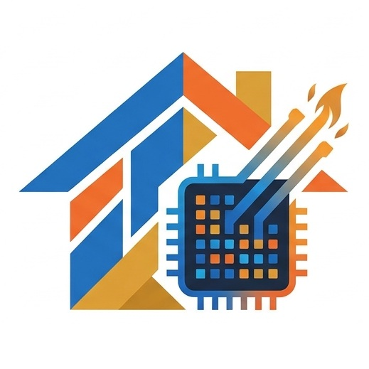

# FlameGPU Housing Agent Based Model (ABM)

# Model description
The model simulates an abstract housing market with cash payments only. 
Households having high capital (above a defined threshold) go into the housing market and buy a house within their budget.

The model is designed to showcase the efficiency gains from FlameGPU, compared to NetLogo.

# Repository conents
The repository includes the following key files:
1. `main.ipynb`: The FlameGPU housing ABM with benchmark runs with all households attempting to move every time step.
2. `NetLogo_benchmark/benchmark_NetLogo.nlogox`: A NetLogo model simulating agents moving in space as applied in FlameGPU for benchmark purposes. Note that the NetLogo model does not simulate the housing market; it only simuates agents moving in space randomly.

